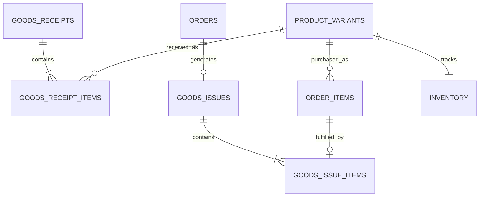

# Hướng dẫn triển khai module kho — Backend đến Frontend

> Dành cho Hùng. Phạm vi: nhập kho và xuất kho theo đơn hàng; nhặt hàng/đóng gói là một phần của xuất kho. Warehouse Staff xác nhận xuất kho. Đây là tài liệu thiết kế và mẫu triển khai, chưa phải code ứng dụng đã chạy.

## Mục lục

1. [Bối cảnh và phạm vi](#1-bối-cảnh-và-phạm-vi)
2. [Kiến trúc và trách nhiệm](#2-kiến-trúc-và-trách-nhiệm)
3. [Cấu trúc thư mục backend](#3-cấu-trúc-thư-mục-backend)
4. [Cấu trúc thư mục frontend](#4-cấu-trúc-thư-mục-frontend)
5. [Database và entity](#5-database-và-entity)
6. [Luồng nghiệp vụ và transaction](#6-luồng-nghiệp-vụ-và-transaction)
7. [API contract](#7-api-contract)
8. [Mẫu backend](#8-mẫu-backend)
9. [TanStack Query](#9-tanstack-query)
10. [Zustand](#10-zustand)
11. [Zod và React Hook Form](#11-zod-và-react-hook-form)
12. [Ghép màn hình hiện có](#12-ghép-màn-hình-hiện-có)
13. [Phân quyền và xử lý lỗi](#13-phân-quyền-và-xử-lý-lỗi)
14. [Thứ tự triển khai](#14-thứ-tự-triển-khai)
15. [Kiểm thử và tiêu chí hoàn tất](#15-kiểm-thử-và-tiêu-chí-hoàn-tất)
16. [Tài liệu tham khảo](#16-tài-liệu-tham-khảo)

## 1. Bối cảnh và phạm vi

### 1.1. Những gì đã có trong repository

- Frontend: React 19, Vite, JavaScript/JSX, React Router, Axios, React Bootstrap, Bootstrap Icons.
- Đã khai báo React Hook Form, `@hookform/resolvers`, Zod trong `frontend/package.json` khi kiểm tra tài liệu này.
- Chưa thấy `@tanstack/react-query` và `zustand` trong manifest đã kiểm tra; nếu nhánh khác đã thêm thì dùng phiên bản nhóm đã chốt.
- Module hiện tại: `frontend/src/modules/goods-receipt-packing/`.
- Có bốn trang: `GoodsReceiptListPage`, `PendingReceiptPage`, `PackingListPage`, `PackingPage`.
- `api/warehouse.api.js` đang trống. Các trang đang dùng mock/state riêng, chưa có dữ liệu kho chung từ backend.
- `shared/api/axiosClient.js` đã gắn access token và trả trực tiếp `response.data`.
- Chưa thấy thư mục backend tại thời điểm khảo sát. README đề xuất Java/Spring với package gốc `com.clothesshop`.

### 1.2. Phương án kỹ thuật cho backend

Tài liệu đề xuất Java 17+, Spring Boot dùng Jakarta, Spring Web, Spring Data JPA, Bean Validation, Spring Security và Flyway. Chọn bản Spring Boot được nhóm thống nhất, để BOM của Boot quản lý phiên bản thư viện liên quan.

Database quan hệ: dùng hệ quản trị nhóm đã chọn; nếu chưa chốt, PostgreSQL là phương án tham chiếu. Các tên bảng ở đây là contract đề xuất, không khẳng định đã tồn tại. Điều chỉnh cú pháp migration theo DB thật, đặc biệt identity, timestamp, unique với NULL và UUID.

Các đoạn Java bên dưới là mẫu trọng tâm, có lược import, getter và các implementation thuộc module khác. Chúng không phải một bộ source có thể copy toàn bộ rồi build ngay. Phải hoàn thiện các contract tích hợp trước khi chạy end-to-end.

### 1.3. Phạm vi nghiệp vụ đã chốt

| Thao tác | Vai trò | Trách nhiệm |
|---|---|---|
| Tạo phiếu nhập | Store Staff | Chọn biến thể, nhập số lượng dự kiến |
| Xác nhận nhập | Warehouse Staff | Kiểm nhận, tăng tồn thực tế |
| Xác nhận đơn | Store Staff | Module đơn hàng, tự sinh phiếu xuất |
| Nhận việc và nhặt hàng | Warehouse Staff | Chuẩn bị hàng theo phiếu xuất |
| Xác nhận đóng gói | Warehouse Staff | Xác nhận đã lấy đủ hàng |
| Xác nhận xuất kho | Warehouse Staff | Bàn giao vận chuyển, giảm tồn và chuyển đơn sang SHIPPING |
| Xác nhận giao thành công | Store Staff | Module đơn hàng, không đổi tồn |

Giới hạn: một kho, một phiếu nhập xác nhận một lần, một đơn xuất toàn bộ một lần. Không triển khai chia kiện, xuất từng phần, nhận nhiều đợt, hủy/hoàn tiền/đổi trả, điều chỉnh tồn thủ công hoặc API vận chuyển.

Đây là điều chỉnh so với tài liệu UC14 ban đầu: quyền xác nhận xuất kho chuyển từ Store Staff sang Warehouse Staff. Cần cập nhật tài liệu phân công và contract với Hiếu; không để hai API ở hai module cùng trừ tồn.

## 2. Kiến trúc và trách nhiệm

### 2.1. Modular monolith theo feature

```text
React page → query/mutation hook → Axios API → REST controller
                                               ↓
                                       Application service
                                               ↓
                              Entity + Repository + Integration ports
                                               ↓
                                Một database, một transaction
```

Không cần microservice, message broker hoặc một kiến trúc nhiều lớp interface/implementation cho mọi class. Tách lớp theo trách nhiệm thực tế; chỉ tạo interface tại ranh giới tích hợp và nơi có nhiều implementation cần thay thế.

### 2.2. Phân biệt ba loại state trên frontend

| Dữ liệu | Công cụ | Ví dụ |
|---|---|---|
| Server state | TanStack Query | Phiếu, chi tiết, thống kê, biến thể, trạng thái đã nhặt |
| UI state dùng giữa component | Zustand | Modal đang mở, tab nhập/xuất đang chọn |
| Form state | React Hook Form + Zod | Dòng tạo phiếu, số lượng thực nhận, form bàn giao |
| Trạng thái điều hướng | URL | ID phiếu, search, status, page, categoryId |

Không copy danh sách phiếu hoặc tồn kho từ Query vào Zustand. Không dùng Zustand/localStorage làm nguồn quyết định tồn kho, phân quyền hoặc trạng thái chứng từ. Không lưu cùng một bộ filter vừa ở URL vừa ở store.

### 2.3. Ranh giới với module khác

| Module | Kho cần gì? | Điểm tích hợp |
|---|---|---|
| Auth/Account — Lý | ID, role, trạng thái tài khoản hiện tại | `CurrentActor` đọc principal đã xác thực |
| Catalog/Stock — Lâm | Biến thể, SKU, tồn thực tế, đang giữ | `CatalogLookup`, `InventoryOperations` |
| Order — Hiếu | Đơn nguồn, các dòng bất biến, cập nhật PACKED/SHIPPING | `OrderWarehousePort`, `WarehouseFulfillment` |
| Cart/Checkout — Công | Giữ hàng thành công trước khi tạo yêu cầu xuất | Contract tồn kho chung; kho không viết lại checkout |

`Inventory` thuộc dữ liệu chung Catalog/Stock, không tạo một bảng tồn thứ hai. Các adapter chạy trong cùng ứng dụng và cùng transaction manager. Không gọi HTTP giữa các module để thực hiện thao tác cần atomic trong một database.

## 3. Cấu trúc thư mục backend

Giữ tên package `goodsreceiptpacking` theo README để tránh đổi tên toàn dự án; bên trong tổ chức theo nhập và xuất.

```text
backend/
├── pom.xml
└── src/
    ├── main/
    │   ├── java/com/clothesshop/
    │   │   ├── ClothesShopApplication.java
    │   │   ├── config/                         # Dùng cấu hình chung của nhóm
    │   │   ├── common/
    │   │   │   ├── security/CurrentActor.java   # Contract dùng chung với auth
    │   │   │   ├── exception/                  # Exception handler chung
    │   │   │   └── response/PageResponse.java
    │   │   └── modules/
    │   │       └── goodsreceiptpacking/
    │   │           ├── api/
    │   │           │   ├── WarehouseFulfillment.java
    │   │           │   └── ConfirmedOrderForIssue.java
    │   │           ├── receipt/
    │   │           │   ├── controller/GoodsReceiptController.java
    │   │           │   ├── dto/
    │   │           │   │   ├── CreateReceiptRequest.java
    │   │           │   │   ├── ConfirmReceiptRequest.java
    │   │           │   │   ├── ReceiptListItemResponse.java
    │   │           │   │   └── ReceiptDetailResponse.java
    │   │           │   ├── entity/
    │   │           │   │   ├── GoodsReceipt.java
    │   │           │   │   ├── GoodsReceiptItem.java
    │   │           │   │   └── GoodsReceiptStatus.java
    │   │           │   ├── repository/
    │   │           │   │   ├── GoodsReceiptRepository.java
    │   │           │   │   └── GoodsReceiptSpecifications.java
    │   │           │   ├── service/
    │   │           │   │   ├── ReceiptCommandService.java
    │   │           │   │   └── ReceiptQueryService.java
    │   │           │   └── mapper/ReceiptMapper.java
    │   │           ├── issue/
    │   │           │   ├── controller/GoodsIssueController.java
    │   │           │   ├── dto/
    │   │           │   │   ├── StartPickingRequest.java
    │   │           │   │   ├── UpdatePickingRequest.java
    │   │           │   │   ├── PackIssueRequest.java
    │   │           │   │   ├── ExportIssueRequest.java
    │   │           │   │   ├── IssueListItemResponse.java
    │   │           │   │   └── IssueDetailResponse.java
    │   │           │   ├── entity/
    │   │           │   │   ├── GoodsIssue.java
    │   │           │   │   ├── GoodsIssueItem.java
    │   │           │   │   ├── GoodsIssueStatus.java
    │   │           │   │   └── PackagingType.java
    │   │           │   ├── repository/GoodsIssueRepository.java
    │   │           │   ├── service/
    │   │           │   │   ├── IssueCommandService.java
    │   │           │   │   ├── IssueQueryService.java
    │   │           │   │   └── WarehouseFulfillmentService.java
    │   │           │   └── mapper/IssueMapper.java
    │   │           ├── integration/
    │   │           │   ├── CatalogLookup.java
    │   │           │   ├── InventoryOperations.java
    │   │           │   ├── OrderWarehousePort.java
    │   │           │   └── adapter/             # Gọi application API của module khác
    │   │           └── support/
    │   │               ├── WarehouseException.java
    │   │               ├── WarehouseErrorCode.java
    │   │               └── WarehouseCodeGenerator.java
    │   └── resources/
    │       └── db/migration/
    │           ├── Vxxx__create_goods_receipts.sql
    │           └── Vxxy__create_goods_issues.sql
    └── test/java/com/clothesshop/modules/goodsreceiptpacking/
        ├── receipt/ReceiptCommandServiceTest.java
        ├── issue/IssueCommandServiceTest.java
        └── integration/
            ├── ReceiptTransactionIT.java
            ├── IssueTransactionIT.java
            └── WarehouseAuthorizationIT.java
```

`Vxxx/Vxxy` là placeholder, thay bằng version migration chưa dùng của cả nhóm. Không tạo migration mới cho bảng users/products/orders nếu nhóm đã có. Test integration transaction nên chạy cùng hệ quản trị DB thật, có thể bằng Testcontainers.

## 4. Cấu trúc thư mục frontend

Giữ JavaScript/JSX và React Bootstrap; không chuyển toàn bộ dự án sang TypeScript hoặc UI framework khác chỉ để làm module kho.

```text
frontend/src/
├── app/
│   ├── providers/AppQueryProvider.jsx          # Wiring chung tối thiểu
│   └── router/
│       ├── RoleRoute.jsx                       # Dùng guard chung nếu nhóm đã có
│       ├── store-staff.routes.jsx              # Chỉ thêm/đổi route kho
│       └── warehouse-staff.routes.jsx
├── shared/api/axiosClient.js                   # Tái sử dụng, không nhân bản
└── modules/goods-receipt-packing/
    ├── api/
    │   ├── warehouse.api.js
    │   └── warehouse.query-keys.js
    ├── queries/
    │   ├── useReceiptQueries.js
    │   ├── useIssueQueries.js
    │   └── useWarehouseLookups.js
    ├── mutations/
    │   ├── useReceiptMutations.js
    │   └── useIssueMutations.js
    ├── schemas/
    │   ├── common.schema.js
    │   ├── receipt.schema.js
    │   └── issue.schema.js
    ├── stores/useWarehouseUiStore.js
    ├── hooks/
    │   ├── useWarehouseSearchParams.js
    │   └── useWarehouseFormErrors.js
    ├── pages/
    │   ├── GoodsReceiptListPage.jsx            # Giữ và nối API
    │   ├── GoodsReceiptDetailPage.jsx          # Thêm chi tiết/read-only
    │   ├── PendingReceiptPage.jsx              # Chọn phiếu và kiểm nhận
    │   ├── GoodsIssueListPage.jsx              # Thay PackingListPage
    │   └── GoodsIssueDetailPage.jsx            # Thay PackingPage
    ├── components/
    │   ├── goods-receipt/
    │   │   ├── GoodsReceiptFilter.jsx
    │   │   ├── GoodsReceiptTable.jsx
    │   │   ├── CreateGoodsReceiptModal.jsx
    │   │   └── ReceiptItemsFields.jsx
    │   ├── pending-receipt/
    │   │   ├── PendingReceiptFilter.jsx
    │   │   └── PendingReceiptTable.jsx
    │   ├── goods-issue/
    │   │   ├── GoodsIssueFilter.jsx
    │   │   ├── GoodsIssueTable.jsx
    │   │   ├── PickingItemsForm.jsx
    │   │   ├── PackingSection.jsx
    │   │   └── ExportIssueModal.jsx
    │   └── common/
    │       ├── WarehouseStatusBadge.jsx
    │       ├── WarehouseSummary.jsx
    │       └── WarehouseFeedback.jsx
    ├── constants/warehouse-status.js
    ├── utils/warehouse-formatters.js
    ├── styles/warehouse.css                    # Tái sử dụng CSS hiện tại
    └── tests/
        ├── receipt.schema.test.js
        ├── issue.schema.test.js
        └── warehouse-flow.test.jsx
```

Không tạo toàn bộ file rỗng ngay từ đầu. Tạo theo từng lát tính năng hoàn chỉnh. Không cần barrel `index.js` ở mọi thư mục; import trực tiếp dễ truy vết hơn ở quy mô nhóm.

## 5. Database và entity

### 5.1. Bốn bảng do kho sở hữu



| Bảng | Cột cần có |
|---|---|
| `goods_receipts` | `id`, `code UNIQUE`, `supplier_name`, `expected_date`, `note`, `status`, `created_by FK`, `created_at`, `confirmed_by FK NULL`, `confirmed_at NULL`, `discrepancy_note NULL`, `version` |
| `goods_receipt_items` | `id`, `goods_receipt_id FK`, `variant_id FK`, `expected_quantity`, `received_quantity NULL` |
| `goods_issues` | `id`, `code UNIQUE`, `order_id FK UNIQUE`, `status`, `created_at`, `assigned_to FK NULL`, `picking_started_at NULL`, `packed_by FK NULL`, `packed_at NULL`, `packaging_type NULL`, `exported_by FK NULL`, `exported_at NULL`, `carrier_name NULL`, `tracking_number NULL`, `note NULL`, `version` |
| `goods_issue_items` | `id`, `goods_issue_id FK`, `order_item_id FK UNIQUE`, `picked_quantity DEFAULT 0` |

Kiểu tham chiếu: ID `BIGINT/Long`, số lượng `INT/Integer`, ngày `DATE/LocalDate`, thời điểm UTC `Instant` với kiểu DB tương ứng, ghi chú tối đa 1000 ký tự, supplier/carrier tối đa 255, code tối đa 40, tracking tối đa 100.

Các bảng tích hợp đã được thống nhất nhưng thuộc module khác:

```text
inventory(variant_id PK/FK, physical_quantity, reserved_quantity, version, updated_at)
order_items(id, order_id, variant_id, quantity, các snapshot tại thời điểm mua)
orders(id, order_code, status, payment_status, ...)
product_variants(id, product_id, sku, color, size, is_active, ...)
users(id, full_name, role, status, ...)
```

Không tạo lại các entity/bảng trên trong module kho. Có thể dùng scalar FK trong entity kho và truy vấn qua port/DTO, vẫn khai báo FOREIGN KEY thật trong migration. Đây là phương án giảm phụ thuộc JPA xuyên module. Trong nội bộ aggregate, dùng quan hệ entity bình thường.

### 5.2. Ràng buộc và chuẩn hóa

- `UNIQUE(goods_receipt_id, variant_id)` trên chi tiết nhập.
- `UNIQUE(order_id)` trên đầu phiếu xuất; `UNIQUE(order_item_id)` trên dòng xuất vì không xuất từng phần.
- `expected_quantity > 0`; `received_quantity IS NULL OR received_quantity >= 0`; `picked_quantity >= 0`.
- `received_quantity = NULL` là chưa kiểm nhận; `0` là kiểm nhận và không chấp nhận hàng vào kho.
- `picked_quantity <= order_items.quantity` là ràng buộc xuyên bảng: kiểm tra tại service, không dùng CHECK tham chiếu bảng khác.
- Không lưu `variant_id` hoặc `requested_quantity` lặp ở dòng xuất; lấy qua `order_item_id`. Dòng đơn không được thay biến thể/số lượng sau khi tạo.
- Không lưu category, tên hàng, size hoặc tổng số lượng trên phiếu nhập; truy vấn/join và tổng hợp khi trả DTO.
- Snapshot của đơn hàng thuộc module đơn hàng, kho đọc để hiển thị lịch sử.
- Không xóa cứng phiếu và biến thể đã phát sinh chứng từ. FK dùng RESTRICT/NO ACTION phù hợp DB.
- Index FK và `(status, created_at, id)` cho danh sách; `(assigned_to, status)` nếu lọc người phụ trách.
- Mỗi phiếu có ít nhất một dòng: service kiểm tra; FK đơn thuần không bảo đảm được điều này.

Các bảng chi tiết không lặp thuộc tính chỉ phụ thuộc vào một phần khóa nghiệp vụ ghép. Thiết kế giữ tối thiểu 2NF; ID tự tăng không phải lý do duy nhất để kết luận chuẩn hóa.

### 5.3. Trạng thái

```java
public enum GoodsReceiptStatus { PENDING, COMPLETED }
public enum GoodsIssueStatus { PENDING, PICKING, PACKED, EXPORTED }
public enum PackagingType { CARTON, PE_BAG }
```

Lưu enum bằng `EnumType.STRING`. `@Version Long version` trên đầu phiếu để từ chối form cũ. Khi chỉ đổi child mà cần version aggregate tăng, phải cập nhật trường đầu phiếu hoặc dùng cơ chế force increment; không mặc định JPA sẽ tăng version cha khi sửa field của child.

### 5.4. Sinh mã và tạo phiếu không trùng

Không sinh mã bằng `COUNT + 1` hoặc độ dài danh sách FE. Dùng sequence/identity + formatter hoặc UUID, với UNIQUE ở DB. Ví dụ ID 42 thành `GR-2026-000042`; sequence có khoảng trống là bình thường.

Đề xuất header `Idempotency-Key: <UUID>` khi tạo phiếu nhập để retry sau mất mạng không tạo trùng. Nếu triển khai, bổ sung `creation_key UUID UNIQUE` và `creation_payload_hash VARCHAR(64)` vào `goods_receipts`; hash payload đã chuẩn hóa, bao gồm actor. Cùng key/cùng payload/cùng actor trả phiếu đã tạo; cùng key khác nội dung trả 409. Khi UNIQUE conflict do request đồng thời, phải rollback transaction lỗi rồi đọc kết quả trong transaction mới; không tiếp tục query trong transaction đã rollback-only. Nếu chưa triển khai cơ chế này thì không tự retry POST tạo phiếu và phải ghi rõ giới hạn khi test.

Đây là hai cột kỹ thuật bổ sung, không thêm bảng nghiệp vụ. Key được tạo lúc mở một form mới và giữ nguyên qua retry; sau khi tạo thành công mới sinh key mới.

## 6. Luồng nghiệp vụ và transaction

### 6.1. Nhập kho

```text
Store Staff tạo phiếu PENDING → Kho kiểm nhận → Kho xác nhận COMPLETED
          Không đổi tồn                        Tăng physical
```

Tạo phiếu:

1. Lấy actor từ security context; kiểm tra Store Staff đang active.
2. Validate header, ít nhất một dòng, biến thể hợp lệ, số lượng nguyên dương và không trùng.
3. Lưu đầu phiếu và toàn bộ chi tiết trong một transaction.
4. Không cập nhật inventory.

Xác nhận nhập:

1. Khóa đầu phiếu `PESSIMISTIC_WRITE`, kiểm tra trạng thái và version.
2. Request phải chứa đúng và đủ tập ID dòng của phiếu, không thiếu/trùng/dòng lạ.
3. Validate số lượng nguyên không âm. Quy ước đề xuất: cho nhận dư, nhưng bất kỳ dòng chênh lệch nào đều cần ghi chú. Đây là lựa chọn triển khai cần phản ánh vào UC, không phải luật đã có sẵn trong tài liệu gốc.
4. Lấy các dòng inventory theo variant ID tăng dần và khóa theo cùng thứ tự.
5. Tăng physical theo số lượng chấp nhận, giữ nguyên reserved.
6. Lưu received của tất cả dòng, người xác nhận, thời điểm, note và COMPLETED.
7. Commit một lần; lỗi bất kỳ bước nào rollback toàn bộ.

Nếu tất cả số lượng đều 0, vẫn cho hoàn tất với ghi chú: chứng từ ghi nhận đợt giao không có hàng được chấp nhận, tồn không tăng. Không tuyên bố đã tăng tồn nếu tổng nhận bằng 0.

### 6.2. Tạo yêu cầu xuất từ đơn đã xác nhận

Module Order gọi application API `WarehouseFulfillment.createForConfirmedOrder(orderId)` trong transaction xác nhận đơn của Hiếu. Kho kiểm tra đơn CONFIRMED, Paid và các dòng nguồn hợp lệ, tạo một GoodsIssue PENDING + đầy đủ dòng, picked = 0.

Một đơn chỉ có một phiếu nhờ UNIQUE(order_id). Gọi lại trả phiếu đã có nếu dữ liệu nguồn trùng. Không dùng `AFTER_COMMIT` fire-and-forget cho yêu cầu phải atomic: nếu sinh phiếu lỗi, việc xác nhận đơn cũng phải rollback. Không giữ hàng thêm vì checkout đã giữ.

### 6.3. Nhận việc và lưu tiến độ nhặt

1. Kho mở phiếu PENDING, nhấn Bắt đầu xử lý.
2. Backend chuyển PICKING, assignedTo = actor, lưu thời điểm.
3. Chỉ người được phân công được sửa tiến độ/đóng gói/xuất trong phiên bản tối thiểu này. Nhân viên kho khác được xem. Chưa có chức năng chuyển người phụ trách; cần bổ sung UC riêng nếu muốn hỗ trợ.
4. Lưu toàn bộ số lượng đã nhặt theo từng dòng bằng PUT; đây là gán giá trị tuyệt đối, không phải cộng thêm.
5. Validate tập dòng chính xác và `0 <= picked <= ordered quantity`.
6. Không đổi physical/reserved.

Hàng thực tế thiếu dù đã giữ: giữ PICKING, ghi note, không cho đóng gói/xuất. Không tự đổi số lượng đơn hoặc sửa tồn để vượt kiểm tra. Xử lý đối chiếu tồn là nghiệp vụ mở rộng, chưa nằm trong phiên bản này.

### 6.4. Đóng gói

- Phiếu phải PICKING, đơn CONFIRMED; mọi dòng đã nhặt đủ.
- Kho chọn loại bao bì và xác nhận.
- Cùng transaction: phiếu PACKED, đơn PACKED, lưu packedBy/At.
- Không đổi tồn.

### 6.5. Xuất kho

- Actor phải Warehouse Staff, được phân công; phiếu và đơn đều PACKED.
- Nhập carrierName, trackingNumber nếu đã có và note; carrier bắt buộc trong phương án UI này, tracking tùy chọn vì không tích hợp vận chuyển.
- Khóa đơn, phiếu, các dòng inventory rồi kiểm tra trạng thái, version và số lượng.
- Giảm physical và reserved cùng số lượng của từng dòng đơn.
- Cùng transaction: phiếu EXPORTED, đơn SHIPPING, lưu exportedBy/At và thông tin bàn giao.
- Không gọi thêm hàm trừ tồn từ module Order. Store Staff không có endpoint xuất kho riêng.

### 6.6. Quy tắc khóa, version và replay

Quy ước toàn nhóm cho thao tác có cả đơn và phiếu: **Order → GoodsIssue → Inventory theo variant ID tăng dần**. Với nhập: GoodsReceipt → Inventory tăng dần. Checkout chỉ khóa inventory theo cùng thứ tự. Không có đường code khóa Inventory rồi quay lại khóa Order.

- `@Version` bảo vệ form stale; pessimistic lock bảo vệ chuyển trạng thái cạnh tranh.
- Mọi writer của inventory, kể cả checkout và nhập kho, phải tuân thủ cùng cơ chế khóa hoặc atomic update. Chỉ khóa ở module kho là chưa đủ.
- Nếu dùng bulk JPQL update, cần kiểm soát version/clear persistence context; ưu tiên cập nhật managed entity có khóa cho bản đầu.
- Sau commit/flush, response phải có version mới; không trả DTO với version cũ rồi để form tiếp tục submit.
- Khi người dùng gửi lại xác nhận terminal sau timeout: nếu trạng thái đã hoàn tất và payload tương đương dữ liệu đã lưu, trả kết quả hiện tại, không tăng/trừ tồn lại. Nếu khác payload, trả 409.
- Kiểm tra quyền trước khi trả kết quả replay. Đối chiếu replay trước kiểm tra version cũ, vì lần thành công đầu đã tăng version.
- Tắt retry mutation tự động. Disable button chỉ hỗ trợ UX, không thay thế idempotency/transaction ở backend.

### 6.7. Mô phỏng đầy đủ

| Bước | Physical | Reserved | Available |
|---|---:|---:|---:|
| Ban đầu | 20 | 0 | 20 |
| Nhập chấp nhận 48 | 68 | 0 | 68 |
| Khách checkout mua 3 | 68 | 3 | 65 |
| Xác nhận đơn, tạo phiếu xuất | 68 | 3 | 65 |
| Nhặt và đóng gói | 68 | 3 | 65 |
| Warehouse xác nhận xuất | 65 | 0 | 65 |
| Store xác nhận giao | 65 | 0 | 65 |

## 7. API contract

Base path tương đối dưới `API_BASE_URL`, ví dụ base `http://localhost:8080/api`, API gọi `/warehouse/...`. Cổng 8080 chỉ là ví dụ backend; FE hiện mặc định base mock cổng 3000. Đổi `.env.local` khi backend sẵn sàng, không đổi cứng axiosClient.

### 7.1. Endpoint và quyền

| Method | Endpoint | Role / điều kiện |
|---|---|---|
| GET | `/warehouse/receipts` | Store + Warehouse |
| GET | `/warehouse/receipts/{id}` | Store + Warehouse |
| POST | `/warehouse/receipts` | Store |
| POST | `/warehouse/receipts/{id}/confirm` | Warehouse |
| GET | `/warehouse/issues` | Warehouse |
| GET | `/warehouse/issues/{id}` | Warehouse |
| POST | `/warehouse/issues/{id}/start-picking` | Warehouse |
| PUT | `/warehouse/issues/{id}/picking` | Warehouse được phân công |
| POST | `/warehouse/issues/{id}/pack` | Warehouse được phân công |
| POST | `/warehouse/issues/{id}/export` | Warehouse được phân công |
| GET | `/warehouse/summary` | Store: chỉ số nhập; Warehouse: nhập và xuất |
| GET | `/warehouse/lookups/categories` | Store + Warehouse |
| GET | `/warehouse/lookups/variants` | Store, tìm để lập phiếu |

Lookup là read adapter từ Catalog, không tạo catalog riêng. Không có public POST tạo phiếu xuất: chỉ tạo qua application API từ xác nhận đơn. Không có DELETE phiếu trong phạm vi này.

### 7.2. Danh sách và filter

```http
GET /warehouse/receipts?search=GR&status=PENDING&categoryId=1&page=0&size=20
GET /warehouse/issues?search=ORD&status=PICKING&assignedToMe=true&page=0&size=20
GET /warehouse/lookups/variants?search=cotton&categoryId=1&page=0&size=20
```

- `page` bắt đầu 0, `size` từ 1 đến 100, sort mặc định `createdAt DESC, id DESC`.
- Receipt search theo mã/nhà cung cấp; issue search theo mã phiếu/mã đơn.
- Filter category dùng EXISTS trên các dòng chi tiết, tránh join nhân bản đầu phiếu và sai count.
- Validate enum/filter và whitelist sort; không đưa trực tiếp tên field tùy ý vào SQL.
- Statistics lấy từ query aggregate, không đếm trên trang đang hiển thị. Contract summary dùng tổng toàn bộ dữ liệu mà actor được phép xem, không phụ thuộc filter danh sách; ghi nhãn UI rõ.

Response danh sách trực tiếp, không bọc thêm `data` trong contract này:

```json
{
  "items": [{ "id": 42, "code": "GR-2026-000042", "status": "PENDING", "supplierName": "Xưởng A", "expectedTotal": 50, "receivedTotal": null }],
  "page": 0,
  "size": 20,
  "totalElements": 1,
  "totalPages": 1
}
```

### 7.3. Request tạo và xác nhận nhập

```json
{
  "supplierName": "Xưởng Dệt Hà Nam",
  "expectedDate": "2026-10-25",
  "note": "Đợt tháng 10",
  "items": [{ "variantId": 101, "expectedQuantity": 50 }]
}
```

POST tạo trả 201 và ReceiptDetailResponse. Header Idempotency-Key dùng khi đã triển khai mục 5.4.

```json
{
  "version": 0,
  "discrepancyNote": "2 áo lỗi không nhập",
  "items": [{ "receiptItemId": 301, "receivedQuantity": 48 }]
}
```

Confirm trả 200 với chi tiết cập nhật. Không nhận actor, status, stock delta từ FE.

### 7.4. Request xử lý xuất

```json
{ "version": 0 }
```

Start picking dùng body trên. PUT tiến độ:

```json
{
  "version": 1,
  "note": "Đã kiểm màu và size",
  "items": [{ "issueItemId": 501, "pickedQuantity": 3 }]
}
```

Pack:

```json
{ "version": 2, "packagingType": "CARTON" }
```

Export:

```json
{
  "version": 3,
  "carrierName": "GHTK",
  "trackingNumber": "GHTK123456",
  "note": "Đã bàn giao đủ kiện"
}
```

Mọi mutation trên trả IssueDetailResponse, gồm `version` mới. Không nhận quantity xuất độc lập: server lấy từ đơn nguồn bất biến.

### 7.5. DTO chi tiết

ReceiptDetailResponse tối thiểu:

```text
id, code, supplierName, expectedDate, note, status, version,
createdBy{id,fullName}, createdAt, confirmedBy?, confirmedAt?, discrepancyNote?,
expectedTotal, receivedTotal?,
items[{id,variantId,sku,productName,color,size,categoryId,categoryName,
       expectedQuantity,receivedQuantity}]
```

IssueDetailResponse tối thiểu:

```text
id, code, status, version, createdAt,
order{id,code,status,receiverName,receiverPhone,receiverAddress,customerNote,paymentStatus},
assignedTo?, pickingStartedAt?, packedBy?, packedAt?, packagingType?,
exportedBy?, exportedAt?, carrierName?, trackingNumber?, note?,
items[{id,orderItemId,variantId,sku,productName,color,size,
       requestedQuantity,pickedQuantity}]
```

`requestedQuantity` là field DTO tính từ `OrderItem.quantity`, không phải cột DB. Không trả entity JPA trực tiếp. Lookup variant phải trả tổ hợp màu/size có thật, không ghép product và size độc lập như mock hiện tại. Chưa có quản lý kệ nên bỏ dữ liệu kệ giả, chỉ hiển thị khi Catalog/Stock có field thật.

### 7.6. Error contract

```json
{
  "code": "WAREHOUSE_VERSION_CONFLICT",
  "message": "Phiếu đã được cập nhật. Hãy tải lại trước khi tiếp tục.",
  "fieldErrors": [{ "field": "items.0.receivedQuantity", "message": "Phải là số nguyên không âm" }],
  "traceId": "request-correlation-id"
}
```

400: dữ liệu sai; 401: chưa đăng nhập; 403: sai role/người phụ trách; 404: không có phiếu; 409: version/status/stock conflict; 500: lỗi bất ngờ. Dùng chung global exception handler của nhóm, không thêm nhiều handler trả định dạng khác nhau.

## 8. Mẫu backend

### 8.1. Entity đầu phiếu và chi tiết nhập

```java
@Entity
@Table(name = "goods_receipts")
public class GoodsReceipt {
    @Id @GeneratedValue(strategy = GenerationType.IDENTITY)
    private Long id;
    @Column(nullable = false, unique = true, length = 40)
    private String code;
    @Column(name = "supplier_name", nullable = false, length = 255)
    private String supplierName;
    private LocalDate expectedDate;
    @Column(length = 1000)
    private String note;
    @Enumerated(EnumType.STRING)
    @Column(nullable = false, length = 20)
    private GoodsReceiptStatus status;
    @Column(nullable = false)
    private Long createdBy;
    @Column(nullable = false)
    private Instant createdAt;
    private Long confirmedBy;
    private Instant confirmedAt;
    @Column(length = 1000)
    private String discrepancyNote;
    @Version
    private Long version;
    @OneToMany(mappedBy = "receipt", cascade = CascadeType.PERSIST)
    private List<GoodsReceiptItem> items = new ArrayList<>();

    protected GoodsReceipt() {}

    public void addItem(GoodsReceiptItem item) {
        items.add(item);
        item.attachTo(this);
    }
    // Factory createPending(...), complete(...), getters; không dùng public setter status tùy ý.
}

@Entity
@Table(name = "goods_receipt_items", uniqueConstraints =
    @UniqueConstraint(columnNames = {"goods_receipt_id", "variant_id"}))
public class GoodsReceiptItem {
    @Id @GeneratedValue(strategy = GenerationType.IDENTITY)
    private Long id;
    @ManyToOne(fetch = FetchType.LAZY, optional = false)
    @JoinColumn(name = "goods_receipt_id", nullable = false)
    private GoodsReceipt receipt;
    @Column(name = "variant_id", nullable = false)
    private Long variantId;
    @Column(nullable = false)
    private Integer expectedQuantity;
    private Integer receivedQuantity;

    protected GoodsReceiptItem() {}
    void attachTo(GoodsReceipt receipt) { this.receipt = receipt; }
    // Constructor hợp lệ, receive(quantity), getters.
}
```

Mapping camelCase→snake_case phải thống nhất cấu hình hoặc ghi rõ `@Column(name=...)` cho mọi trường. Không dùng Lombok `@Data` trên aggregate có quan hệ hai chiều để tránh equals/toString đệ quy. FK scalar vẫn cần migration tạo ràng buộc DB thật.

GoodsIssue mapping tương tự, items là OneToMany PERSIST, orderId UNIQUE. GoodsIssueItem chỉ có FK tới đầu phiếu và scalar orderItemId; không cascade sang OrderItem. Tạo các method chuyển trạng thái có guard: `startPicking`, `updatePicking`, `pack`, `export`.

### 8.2. Bean Validation

```java
public record CreateReceiptRequest(
    @NotBlank @Size(max = 255) String supplierName,
    @NotNull LocalDate expectedDate,
    @Size(max = 1000) String note,
    @NotEmpty @Size(max = 200) List<@NotNull @Valid Line> items
) {
    public record Line(@NotNull @Positive Long variantId,
                       @NotNull @Positive Integer expectedQuantity) {}
}

public record ConfirmReceiptRequest(
    @NotNull @PositiveOrZero Long version,
    @Size(max = 1000) String discrepancyNote,
    @NotEmpty @Size(max = 200) List<@NotNull @Valid Line> items
) {
    public record Line(@NotNull @Positive Long receiptItemId,
                       @NotNull @PositiveOrZero Integer receivedQuantity) {}
}
```

Bean Validation kiểm tra hình dạng. Service kiểm tra tập ID chính xác, duplicate, FK có thật, chênh lệch cần note và trạng thái. Từ chối decimal cho field integer trong cấu hình JSON binding; không để Jackson âm thầm cắt `1.5` thành `1`. Expected date không bắt buộc ở tương lai vì có thể lập hồ sơ cho hàng nhận trong ngày/quá khứ.

### 8.3. Repository khóa đầu phiếu

```java
public interface GoodsReceiptRepository extends JpaRepository<GoodsReceipt, Long> {
    @Lock(LockModeType.PESSIMISTIC_WRITE)
    @Query("select r from GoodsReceipt r where r.id = :id")
    Optional<GoodsReceipt> findForUpdate(@Param("id") Long id);
}
```

Khóa đầu phiếu trước, rồi load collection trong transaction. Tránh fetch join collection cùng phân trang hoặc ép outer join collection vào query FOR UPDATE. Query list dùng projection/paging; query detail fetch items và batch lookup để tránh N+1.

### 8.4. Application service xác nhận nhập — thuật toán

```java
@Transactional
public ReceiptDetailResponse confirm(Long id, ConfirmReceiptRequest request) {
    var actor = currentActor.requireWarehouseStaff();
    var receipt = receipts.findForUpdate(id).orElseThrow(notFound(id));
    // helper dưới đây là contract cần implement theo mục 6.
    if (receipt.isCompleted()) {
        requireEquivalentReplay(receipt, request);
        return mapper.toDetail(receipt);
    }
    requireVersion(receipt.getVersion(), request.version());
    requirePending(receipt);
    var quantities = validateExactReceiptLines(receipt, request.items());
    requireDiscrepancyNoteIfNeeded(receipt, quantities, request.discrepancyNote());
    // Port kiểm tra overflow, khóa inventory theo variantId tăng dần,
    // tăng physical, giữ nguyên reserved, tham gia transaction hiện tại.
    inventory.receiveAccepted(toVariantDeltas(receipt, quantities));
    receipt.complete(quantities, request.discrepancyNote(), actor.id(), clock.instant());
    entityManager.flush();
    return mapper.toDetail(receipt);
}
```

Inject `Clock`, không rải `Instant.now()` ở nhiều lớp để dễ kiểm thử. Các business exception là RuntimeException hoặc cấu hình rollbackFor phù hợp. Không catch lỗi rồi trả success trong transaction.

### 8.5. Port tích hợp và xác nhận xuất

```java
public interface InventoryOperations {
    void receiveAccepted(Map<Long, Integer> quantityByVariant);
    void exportReserved(Map<Long, Integer> quantityByVariant);
}

public interface WarehouseFulfillment {
    Long createForConfirmedOrder(Long orderId);
}
```

`InventoryOperations` do adapter đến Catalog/Stock thực thi; không mở `REQUIRES_NEW`. Có thể yêu cầu `Propagation.MANDATORY` ở các operation nội bộ để không vô tình chạy tách transaction.

Pseudocode export:

```text
@Transactional
actor = require Warehouse Staff active
orderId = đọc orderId bất biến từ issue (chưa khóa)
order = OrderWarehousePort.lockOrder(orderId)
issue = issueRepository.findForUpdate(issueId)
kiểm tra orderId của issue đúng order vừa khóa
kiểm tra assignedTo == actor.id
nếu EXPORTED và request tương đương: trả kết quả hiện tại
kiểm tra version, issue PACKED, order PACKED, tất cả dòng nhặt đủ
đọc dòng đơn bất biến, xác minh mọi orderItem thuộc đúng order
gom quantity theo variantId, kiểm tra integer overflow
InventoryOperations.exportReserved(deltas)
issue.export(carrier, tracking, note, actor.id, now)
OrderWarehousePort.markShipping(orderId)
flush → DTO version mới → commit
```

Đơn PACKED nhưng phiếu không PACKED hoặc ngược lại là conflict, không tự chữa bằng FE. Không chuyển trạng thái đơn qua HTTP. Đặt `@Transactional` trên public application service được gọi qua Spring proxy; self-invocation không tự mở transaction mới.

### 8.6. Controller và security

```java
@RestController
@RequestMapping("/api/warehouse/receipts")
public class GoodsReceiptController {
    private final ReceiptCommandService commands;
    public GoodsReceiptController(ReceiptCommandService commands) {
        this.commands = commands;
    }

    @PostMapping("/{id}/confirm")
    @PreAuthorize("hasRole('WAREHOUSE_STAFF')")
    public ReceiptDetailResponse confirm(
        @PathVariable Long id, @Valid @RequestBody ConfirmReceiptRequest request
    ) {
        return commands.confirm(id, request);
    }
}
```

`hasRole` phù hợp nếu GrantedAuthority dùng prefix `ROLE_`. Nếu auth đang dùng authority trần thì dùng `hasAuthority` tương ứng; không trộn. Bật method security trong config chung. Service vẫn kiểm tra assignedTo/trạng thái account. Không dựa vào role từ request body hoặc localStorage.

## 9. TanStack Query

### 9.1. Cài đặt và provider

Chạy ở `frontend/` khi bắt đầu triển khai, không phải tài liệu này tự cài:

```bash
npm install @tanstack/react-query@^5 zustand@^5
```

Zod/RHF/resolvers đã có thì không cần cài lại. Commit lockfile khi thực sự cài. Các ví dụ Query dùng object API v5.

```jsx
// app/providers/AppQueryProvider.jsx
import { QueryClient, QueryClientProvider } from '@tanstack/react-query';

const queryClient = new QueryClient({
  defaultOptions: {
    queries: {
      staleTime: 15_000,
      refetchOnWindowFocus: true,
      retry: (count, error) => {
        const status = error?.response?.status;
        return count < 1 && (!status || status >= 500);
      },
    },
    mutations: { retry: false },
  },
});

export default function AppQueryProvider({ children }) {
  return <QueryClientProvider client={queryClient}>{children}</QueryClientProvider>;
}
```

Wrap App/RouterProvider một lần, giữ CartProvider hiện tại. Nếu app đã có QueryClientProvider thì tái sử dụng. Đăng xuất/đổi user phải cancel query, clear cache và reset UI store; mutation đang chạy không thể đơn giản hủy như query. Không cho user mới thao tác khi request của phiên cũ chưa được xử lý xong.

### 9.2. API adapter

```js
// api/warehouse.api.js
import axiosClient from '../../../shared/api/axiosClient';

export const warehouseApi = {
  listReceipts: (params, signal) =>
    axiosClient.get('/warehouse/receipts', { params, signal }),
  receipt: (id, signal) =>
    axiosClient.get(`/warehouse/receipts/${id}`, { signal }),
  createReceipt: (payload, creationKey) =>
    axiosClient.post('/warehouse/receipts', payload, {
      headers: { 'Idempotency-Key': creationKey },
    }),
  confirmReceipt: (id, payload) =>
    axiosClient.post(`/warehouse/receipts/${id}/confirm`, payload),
  listIssues: (params, signal) =>
    axiosClient.get('/warehouse/issues', { params, signal }),
  issue: (id, signal) =>
    axiosClient.get(`/warehouse/issues/${id}`, { signal }),
  startPicking: (id, payload) =>
    axiosClient.post(`/warehouse/issues/${id}/start-picking`, payload),
  updatePicking: (id, payload) =>
    axiosClient.put(`/warehouse/issues/${id}/picking`, payload),
  packIssue: (id, payload) =>
    axiosClient.post(`/warehouse/issues/${id}/pack`, payload),
  exportIssue: (id, payload) =>
    axiosClient.post(`/warehouse/issues/${id}/export`, payload),
};
```

Do axios interceptor đã trả response.data nên không viết `.then(r => r.data)` lần nữa. Thêm summary/lookups tương tự. Nếu backend nhóm chọn envelope `{data:...}`, normalize đúng một lần tại API boundary, không sửa mọi component tùy tiện.

### 9.3. Query key factory và hook

```js
// api/warehouse.query-keys.js
export const warehouseKeys = {
  all: ['warehouse'],
  receipts: () => ['warehouse', 'receipts'],
  receiptList: (filters) => ['warehouse', 'receipts', 'list', filters],
  receipt: (id) => ['warehouse', 'receipts', 'detail', String(id)],
  issues: () => ['warehouse', 'issues'],
  issueList: (filters) => ['warehouse', 'issues', 'list', filters],
  issue: (id) => ['warehouse', 'issues', 'detail', String(id)],
  summary: () => ['warehouse', 'summary'],
};
```

Các biến ảnh hưởng kết quả phải nằm trong key; normalize page/status/search trước khi tạo key. Query key không chứa form đang nhập hoặc modal state. Tổ chức key theo hướng dẫn [TanStack Query Keys](https://tanstack.com/query/latest/docs/framework/react/guides/query-keys).

```js
// queries/useReceiptQueries.js
import { useQuery } from '@tanstack/react-query';
import { warehouseApi } from '../api/warehouse.api';
import { warehouseKeys } from '../api/warehouse.query-keys';

export function useReceiptDetail(id) {
  return useQuery({
    queryKey: warehouseKeys.receipt(id),
    queryFn: ({ signal }) => warehouseApi.receipt(id, signal),
    enabled: Boolean(id),
  });
}
```

### 9.4. Mutation và invalidation

```js
// mutations/useReceiptMutations.js
import { useMutation, useQueryClient } from '@tanstack/react-query';
import { warehouseApi } from '../api/warehouse.api';
import { warehouseKeys } from '../api/warehouse.query-keys';

export function useConfirmReceipt() {
  const client = useQueryClient();
  return useMutation({
    mutationFn: ({ id, payload }) => warehouseApi.confirmReceipt(id, payload),
    onSuccess: async (receipt) => {
      await client.cancelQueries({ queryKey: warehouseKeys.receipt(receipt.id) });
      client.setQueryData(warehouseKeys.receipt(receipt.id), receipt);
      await Promise.all([
        client.invalidateQueries({ queryKey: warehouseKeys.receipts() }),
        client.invalidateQueries({ queryKey: warehouseKeys.summary() }),
        // Thay prefix dưới bằng key factory của Lâm khi tích hợp.
        client.invalidateQueries({ queryKey: ['inventory'] }),
      ]);
    },
    onError: async (error, { id }) => {
      if (error?.response?.status === 409) {
        await client.invalidateQueries({ queryKey: warehouseKeys.receipt(id) });
      }
    },
  });
}
```

Await invalidation trong `onSuccess` để trạng thái pending bao phủ việc refresh dữ liệu liên quan; xem [Invalidations from Mutations](https://tanstack.com/query/latest/docs/framework/react/guides/invalidations-from-mutations). Không optimistic update tồn hoặc trạng thái hoàn tất vì server có thể từ chối do xung đột.

| Mutation | Query phải refresh |
|---|---|
| Tạo phiếu nhập | Receipt list, summary |
| Xác nhận nhập | Receipt detail/list, summary, inventory |
| Start/Save picking | Issue detail/list, summary |
| Pack | Issue detail/list, summary, order detail/list |
| Export | Issue detail/list, summary, inventory, order detail/list |

`['inventory']` và `['orders']` chỉ là prefix contract đề xuất; import key factory thật của Lâm/Hiếu khi có. Không viết lại query layer của các module khác trong task kho. Sau export làm mới dữ liệu server, không tự trừ cả tồn trong Zustand rồi lại refetch.

Query invalidation chỉ tác động tab hiện tại. Dùng refetchOnWindowFocus cho stale data; nếu cần tự cập nhật khi nhân viên khác thao tác, có thể thêm polling 15–30 giây cho danh sách phiếu đang xử lý. Không refetch rồi reset form đang dirty. Không cần WebSocket cho bản này.

## 10. Zustand

Chỉ dùng UI state ngắn hạn, không persist chứng từ hoặc thông tin khách hàng. Dùng selector nhỏ để giảm render; hướng dẫn API cơ bản ở [Zustand create](https://zustand.docs.pmnd.rs/reference/apis/create.html).

```js
// stores/useWarehouseUiStore.js
import { create } from 'zustand';

const initialUi = {
  createReceiptOpen: false,
  exportIssueId: null,
  activeWorkspace: 'receipts',
};

export const useWarehouseUiStore = create((set) => ({
  ...initialUi,
  openCreateReceipt: () => set({ createReceiptOpen: true }),
  closeCreateReceipt: () => set({ createReceiptOpen: false }),
  openExport: (id) => set({ exportIssueId: id }),
  closeExport: () => set({ exportIssueId: null }),
  setActiveWorkspace: (activeWorkspace) => set({ activeWorkspace }),
  resetUi: () => set({ ...initialUi }),
}));
```

```jsx
const isOpen = useWarehouseUiStore((s) => s.createReceiptOpen);
const close = useWarehouseUiStore((s) => s.closeCreateReceipt);
```

Route param là nguồn của phiếu đang xem. Không dùng thêm `selectedIssue` object trong store. Nếu một modal chỉ dùng trong một component thì useState cũng phù hợp; không ép mọi state vào Zustand.

## 11. Zod và React Hook Form

Zod kiểm tra form phía client; Bean Validation + service + DB vẫn là nguồn kiểm tra có thẩm quyền. Dùng các API schema/refinement theo [Zod API](https://zod.dev/api). Không chấp nhận input trống bị ép thành 0 khi số 0 là một giá trị nghiệp vụ hợp lệ.

### 11.1. Schema cơ bản

```js
// schemas/common.schema.js
import { z } from 'zod';

const numberInput = (value) => {
  if (value === '' || value == null ||
      (typeof value === 'string' && value.trim() === '')) return undefined;
  return typeof value === 'string' ? Number(value) : value;
};

export const nonNegativeInteger = z.preprocess(
  numberInput, z.number().int().min(0).max(2_147_483_647),
);
export const positiveInteger = z.preprocess(
  numberInput, z.number().int().min(1).max(2_147_483_647),
);
export const idSchema = z.preprocess(
  numberInput, z.number().int().positive().max(Number.MAX_SAFE_INTEGER),
);
export const versionSchema = z.number().int().nonnegative().max(Number.MAX_SAFE_INTEGER);
```

Backend Long phải được serialize theo contract ID của nhóm. Ví dụ này dùng JSON number trong giới hạn safe integer; nếu nhóm dùng ID vượt giới hạn đó, chuyển toàn bộ ID sang string ở API/schema, không ép Number.

### 11.2. Tạo phiếu nhập

```js
// schemas/receipt.schema.js
import { z } from 'zod';
import { idSchema, positiveInteger, nonNegativeInteger, versionSchema } from './common.schema';

export const createReceiptSchema = z.object({
  supplierName: z.string().trim().min(1, 'Nhập nhà cung cấp').max(255),
  expectedDate: z.iso.date(),
  note: z.string().trim().max(1000),
  items: z.array(z.object({
    variantId: idSchema,
    expectedQuantity: positiveInteger,
  })).min(1, 'Cần ít nhất một sản phẩm').max(200),
}).superRefine((value, ctx) => {
  const seen = new Set();
  value.items.forEach((item, index) => {
    if (seen.has(item.variantId)) ctx.addIssue({
      code: 'custom', path: ['items', index, 'variantId'],
      message: 'Biến thể đã có, hãy gộp số lượng',
    });
    seen.add(item.variantId);
  });
});

export function makeConfirmReceiptSchema(receipt) {
  const expected = new Map(receipt.items.map((i) => [i.id, i.expectedQuantity]));
  return z.object({
    version: versionSchema,
    discrepancyNote: z.string().trim().max(1000),
    items: z.array(z.object({
      receiptItemId: idSchema,
      receivedQuantity: nonNegativeInteger,
    })).min(1).max(200),
  }).superRefine((value, ctx) => {
    const ids = value.items.map((i) => i.receiptItemId);
    if (new Set(ids).size !== ids.length || ids.length !== expected.size ||
        ids.some((id) => !expected.has(id))) {
      ctx.addIssue({ code: 'custom', path: ['items'], message: 'Danh sách dòng phiếu không hợp lệ' });
    }
    const mismatch = value.items.some((i) =>
      expected.has(i.receiptItemId) && i.receivedQuantity !== expected.get(i.receiptItemId));
    if (mismatch && !value.discrepancyNote) ctx.addIssue({
      code: 'custom', path: ['discrepancyNote'], message: 'Nhập lý do chênh lệch',
    });
  });
}
```

Đối chiếu từng dòng, không chỉ tổng số lượng: một dòng dư 2 và một dòng thiếu 2 vẫn là chênh lệch dù tổng bằng nhau.

### 11.3. Nhặt, đóng gói và xuất

```js
// schemas/issue.schema.js
import { z } from 'zod';
import { idSchema, nonNegativeInteger, versionSchema } from './common.schema';

export function makePickingSchema(issue) {
  const expected = new Map(issue.items.map((i) => [i.id, i.requestedQuantity]));
  return z.object({
    version: versionSchema,
    note: z.string().trim().max(1000),
    items: z.array(z.object({
      issueItemId: idSchema,
      pickedQuantity: nonNegativeInteger,
    })).min(1).max(200),
  }).superRefine((value, ctx) => {
    const ids = value.items.map((i) => i.issueItemId);
    if (new Set(ids).size !== ids.length || ids.length !== expected.size ||
        ids.some((id) => !expected.has(id))) ctx.addIssue({
      code: 'custom', path: ['items'], message: 'Danh sách dòng xuất không hợp lệ',
    });
    value.items.forEach((line, index) => {
      if (expected.has(line.issueItemId) &&
          line.pickedQuantity > expected.get(line.issueItemId)) ctx.addIssue({
        code: 'custom', path: ['items', index, 'pickedQuantity'],
        message: 'Vượt số lượng cần xuất',
      });
    });
  });
}

export const packIssueSchema = z.object({
  version: versionSchema,
  packagingType: z.enum(['CARTON', 'PE_BAG']),
});

export const exportIssueSchema = z.object({
  version: versionSchema,
  carrierName: z.string().trim().min(1, 'Nhập đơn vị vận chuyển').max(255),
  trackingNumber: z.string().trim().max(100),
  note: z.string().trim().max(1000),
});
```

Pack schema kiểm tra payload; điều kiện đủ hàng lấy từ chi tiết server và kiểm tra lại tại backend. FE disable nút nếu `!issue.items.every(i => i.pickedQuantity === i.requestedQuantity)` hoặc form tiến độ chưa lưu.

### 11.4. Ghép form

```jsx
import { useForm, useFieldArray } from 'react-hook-form';
import { zodResolver } from '@hookform/resolvers/zod';
import { createReceiptSchema } from '../schemas/receipt.schema';

const form = useForm({
  resolver: zodResolver(createReceiptSchema),
  defaultValues: {
    supplierName: '', expectedDate: '', note: '',
    items: [{ variantId: '', expectedQuantity: 1 }],
  },
});
const lines = useFieldArray({ control: form.control, name: 'items' });
// Render lines.fields, key={field.id}; append/remove qua useFieldArray.
// <input {...form.register(`items.${index}.expectedQuantity`)} type="number" min="1" step="1" />
// form.handleSubmit nhận giá trị đã parse, gọi mutation.mutateAsync rồi đóng modal khi thành công.
```

Không dùng index làm React key của dòng form có thể xóa/thêm. Với form xác nhận nhập, để trống received lúc đầu và có nút rõ ràng “Điền bằng dự kiến” nếu muốn; không âm thầm biến NULL thành 0 hoặc xem như đã kiểm.

Khi mở phiếu khác, reset form theo ID mới. Khi background refetch cùng ID, không reset form dirty. Khi 409, thông báo dữ liệu đã đổi, tải chi tiết mới và yêu cầu người dùng đối chiếu/reset có chủ đích; không tự gửi lại form cũ.

Khi lưu picking thành công, reset form bằng response/version mới. Chỉ cho pack sau khi save tiến độ hoàn tất. Các action trên cùng phiếu phải serialize; trong lúc một mutation pending, disable các action còn lại.

Map `fieldErrors` từ backend sang `form.setError(field, {type:'server',message})`. Giữ dữ liệu người dùng nhập khi lỗi. Lỗi không gắn field đặt ở `root.server`/Alert chung. Không đóng modal trong `finally`; chỉ đóng sau success.

## 12. Ghép màn hình hiện có

### 12.1. Mapping màn hình

| Hiện tại | Thực hiện |
|---|---|
| `GoodsReceiptListPage` | Bỏ INITIAL_RECEIPTS, dùng useQuery list/summary; create dùng mutation |
| `CreateGoodsReceiptModal` | RHF + Zod + useFieldArray; chọn variant có thật từ lookup |
| `GoodsReceiptFilter` | Đọc/ghi URL, debounce search, đổi filter reset page = 0 |
| `GoodsReceiptTable` | Hiển thị DTO; chi tiết thật thay alert; bỏ nút Store tự xác nhận nhập |
| `PendingReceiptPage` | List PENDING + detail + confirm mutation, không dùng MOCK_PENDING_DATA |
| `PendingReceiptTable` | Form nhập received/note, khóa read-only nếu COMPLETED |
| `PackingListPage` | Chuyển thành GoodsIssueListPage, lọc theo trạng thái phiếu xuất |
| `PackingPage` | Chuyển thành GoodsIssueDetailPage, có start/save picking/pack/export |
| `PackingTableDetail` | Tách PickingItemsForm + PackingSection; bắt buộc đủ mọi dòng |
| `warehouse.css` | Giữ namespace `.goods-receipt-packing`, bổ sung style cần thiết |

Không nhét UC06/UC09 hoặc thông tin transaction vào nội dung dành cho người dùng. Label nghiệp vụ: “Phiếu nhập”, “Kiểm nhận”, “Phiếu xuất”, “Nhặt hàng”, “Đóng gói”, “Bàn giao và xuất kho”.

### 12.2. Route đề xuất

```text
/store-staff/goods-receipts              Danh sách và tạo phiếu nhập
/store-staff/goods-receipts/:receiptId   Chi tiết chỉ đọc

/warehouse-staff/pending-receipts        Danh sách/chọn phiếu chờ
/warehouse-staff/receipts/:receiptId     Kiểm nhận hoặc xem phiếu hoàn tất
/warehouse-staff/goods-issues            Danh sách phiếu xuất
/warehouse-staff/goods-issues/:issueId   Chi tiết xử lý xuất
```

ID thật trên route, code để hiển thị/tìm kiếm. Link cũ `packing/:orderCode` không thể redirect bằng cách xem orderCode là issueId. Trong giai đoạn chuyển tiếp, redirect `/packing` về danh sách mới, và xử lý link chi tiết cũ bằng lookup orderCode hoặc đưa về danh sách kèm search. Query receiptCode cũ cũng cần resolve hoặc chuyển UI sang receiptId có kiểm soát.

### 12.3. Trạng thái action trên chi tiết xuất

| Status | Action chính | Điều kiện |
|---|---|---|
| PENDING | Bắt đầu xử lý | Warehouse, chưa có người nhận |
| PICKING | Lưu tiến độ | Đúng người phụ trách, form hợp lệ |
| PICKING | Xác nhận đóng gói | Tất cả dòng đã nhặt đủ và đã lưu |
| PACKED | Bàn giao và xuất kho | Đúng người phụ trách, form bàn giao hợp lệ |
| EXPORTED | Xem chứng từ | Không sửa, không xuất lại |

UI cần loading, empty, lỗi và retry đọc dữ liệu, pending button, Alert/toast success, trạng thái chỉ đọc khi xong. Không dùng setTimeout giả xử lý hoặc alert tuyên bố tăng/trừ tồn trước khi server xác nhận.

Summary kiểm nhận phải tính thật. Bỏ các card hardcode “1 phiếu chênh lệch”, “218 sp”. Nếu thống kê dựa trên form đang kiểm, ghi rõ là thống kê của phiếu đang mở.

## 13. Phân quyền và xử lý lỗi

- Guard route kho và Store theo role, dùng lại auth context/provider nếu đã có. Guard FE chỉ phục vụ điều hướng; backend kiểm tra mọi endpoint.
- Store được xem/tạo phiếu nhập, không xác nhận nhập/xuất. Warehouse đọc phiếu nhập và xử lý xuất.
- Customer/Admin không truy cập API nghiệp vụ kho trong phạm vi đã chốt.
- ID đã biết không có nghĩa có quyền mutate; service kiểm tra owner nghiệp vụ/assignedTo.
- User ID/role lấy từ principal, không từ localStorage gửi lên body.
- Không cascade xóa User/Product/Order từ chứng từ kho.
- Dùng DTO để không lộ password/hash, dữ liệu nội bộ hoặc collection đệ quy.
- CORS cho FE origin thật; Security config chung bật đúng role, không permitAll toàn `/warehouse/**` để test nhanh.
- `.env.local`: `VITE_API_BASE_URL=http://localhost:8080/api` khi backend dùng cổng đó; env là cấu hình, không đặt token vào file này.
- Log code phiếu/action/actor/traceId, không log token hoặc toàn bộ dữ liệu cá nhân người nhận không cần thiết.

## 14. Thứ tự triển khai

### Giai đoạn 1 — Chốt contract và nền tảng

1. Thống nhất với Lâm ID variant, inventory API và khóa tồn; với Hiếu trạng thái đơn, immutable order items và application API tạo phiếu xuất.
2. Chốt Warehouse là người export; loại bỏ đường Store tự trừ tồn.
3. Chọn DB/backend version, auth principal, error/page response của nhóm.
4. Tạo bốn bảng kho sau migration users/catalog/orders. Thiết lập FK, unique, checks, indexes.

### Giai đoạn 2 — Backend nhập kho

1. Entity + DTO + repository.
2. List/detail/lookup, tạo phiếu PENDING.
3. Confirm nhập transaction và InventoryOperations adapter.
4. Kiểm tra rollback, xác nhận lặp, cạnh tranh đồng thời và phân quyền.

### Giai đoạn 3 — Backend xuất kho

1. Application API sinh phiếu khi xác nhận đơn, cùng transaction.
2. List/detail/start picking/save picking.
3. Pack cập nhật cả phiếu và đơn.
4. Export cập nhật phiếu, đơn, physical/reserved trong một transaction.
5. Kiểm thử đủ dòng, sai orderItem, sai người nhận việc và replay.

### Giai đoạn 4 — Frontend nối API

1. Thêm dependencies/provider một lần.
2. Query keys, API adapter, query và mutation hooks.
3. Schema Zod, RHF cho create/confirm/picking/export.
4. Nối màn nhập trước, sau đó chuyển packing thành xuất kho.
5. Thêm route guard/sidebar kho, xử lý URL cũ, bỏ mock khỏi các màn đã nối.
6. Kiểm tra cache refresh cả list/detail/summary và liên kết order/inventory.

### Giai đoạn 5 — Tích hợp và bàn giao

1. Chạy flow từ dữ liệu thật đã seed bởi module sản phẩm/đơn.
2. Không tạo backdoor kho để dựng đơn giả trên môi trường thật. Fixture chỉ dùng trong test/dev.
3. Ghi API contract cuối vào tài liệu nhóm; giữ phạm vi commit kho và wiring liên quan.

## 15. Kiểm thử và tiêu chí hoàn tất

### 15.1. Backend: các test có giá trị nghiệp vụ

| Trường hợp | Kết quả cần có |
|---|---|
| Tạo phiếu hợp lệ | PENDING, đủ dòng, tồn không đổi |
| Trùng variant/quantity sai | 400, không có dữ liệu dở dang |
| Confirm thiếu/trùng/dòng lạ | Từ chối, tồn không đổi |
| Có chênh lệch không note | Từ chối, kể cả tổng chênh lệch bằng 0 |
| Received = 0 | Lưu 0 thật, không coi là chưa nhập |
| Confirm nhận 48 | Physical +48, reserved giữ nguyên |
| Hai request confirm cùng phiếu | Chỉ tăng tồn một lần |
| Một inventory update lỗi | Mọi dòng/đầu phiếu rollback |
| Xác nhận đơn lỗi tạo phiếu xuất | Đơn không bị commit CONFIRMED một mình |
| Hai request sinh phiếu cùng đơn | Một phiếu duy nhất |
| Hai người nhận cùng phiếu | Chỉ một người thành assignedTo |
| Pick vượt số lượng/sai dòng đơn | Từ chối |
| Pack chưa đủ mọi dòng | Từ chối, đơn giữ CONFIRMED |
| Export từ PICKING | Từ chối |
| Export hợp lệ 3 | Physical -3, reserved -3, phiếu EXPORTED, đơn SHIPPING |
| Export bị lỗi cập nhật đơn | Tồn và phiếu rollback |
| Export lặp hoặc concurrent | Không trừ hai lần |
| Nhập và checkout/export đồng thời | Không lost update, invariant tồn luôn đúng |
| Sai role hoặc sai assignedTo | 403 |
| Version cũ | 409, không thay đổi dữ liệu |

Test đồng thời dùng transaction/kết nối riêng và DB thật; không suy luận an toàn concurrency chỉ từ unit test mock repository. Kiểm tra sau transaction kết thúc để bắt lỗi flush/commit.

### 15.2. Frontend

- Zod: blank, 0, số âm, số lẻ, duplicate ID, sai tập dòng, note chênh lệch.
- Form mở phiếu A rồi B không giữ nhầm dữ liệu; background refetch không xóa nội dung đang nhập.
- Mutation lỗi giữ form; success đóng/reset đúng và cập nhật version.
- Chỉ nhặt một dòng không được pack; còn thay đổi chưa save không được pack.
- 409 có thông báo và cơ chế tải lại; không tự submit lại.
- Export xong list/detail/summary/tồn/đơn nhất quán.
- Logout rồi đăng nhập tài khoản khác không thấy cache phiên cũ.
- Direct URL sai role bị chặn, API vẫn từ chối nếu gọi ngoài UI.

Khi triển khai thực tế chạy `npm run lint`, `npm run build`, test FE nếu đã cấu hình runner; backend chạy bộ test qua Maven wrapper nếu được tạo. Các runner Vitest/Testing Library/Testcontainers chưa được xác nhận có trong repo; chỉ bổ sung khi viết các test này, không giả định lệnh `npm test` đã tồn tại.

### 15.3. Definition of Done

- Không còn mock độc lập ở các màn kho đã chuyển API.
- Có 4 entity kho, migration hợp lệ và FK tới dữ liệu chung.
- Có đủ list/detail/create receipt/confirm/start/save picking/pack/export.
- Warehouse xác nhận xuất, Store không còn đường xuất riêng.
- Không cộng/trừ tồn hai lần, không cập nhật đơn/tồn tách transaction.
- Query là nguồn server state, Zustand chỉ UI, RHF + Zod quản lý form.
- Endpoint và component chỉ trong kho hoặc wiring tối thiểu liên quan; không viết lại auth/catalog/cart/order.
- Các test nghiệp vụ quan trọng và build/lint phù hợp đã pass; ghi rõ check nào chưa chạy nếu môi trường thiếu.

## 16. Tài liệu tham khảo

Nguồn dự án: README, tài liệu “Phân công Module, Use Case và Màn hình Nhóm 3.txt”, các file FE trong `src/modules/goods-receipt-packing`, router Store/Warehouse và shared Axios client. Thiết kế phiếu xuất là phần mở rộng đã thống nhất trong trao đổi, không phải bảng đã có sẵn trong source.

- [TanStack Query — Query keys](https://tanstack.com/query/latest/docs/framework/react/guides/query-keys)
- [TanStack Query — Invalidation sau mutation](https://tanstack.com/query/latest/docs/framework/react/guides/invalidations-from-mutations)
- [Zustand — create](https://zustand.docs.pmnd.rs/reference/apis/create.html)
- [Zod — API và schema refinement](https://zod.dev/api)
- [Spring Data JPA — Locking](https://docs.spring.io/spring-data/jpa/reference/jpa/locking.html)
- [Spring Data JPA — Transactionality](https://docs.spring.io/spring-data/jpa/reference/jpa/transactions.html)

Các cấu trúc và code minh họa trong tài liệu là đề xuất riêng cho dự án. Tham khảo Spring về cách khai báo lock và transaction; các quy tắc thứ tự khóa, replay, permission và đồng bộ nhập/xuất phải được nhóm tự triển khai và kiểm thử theo contract ở trên.
